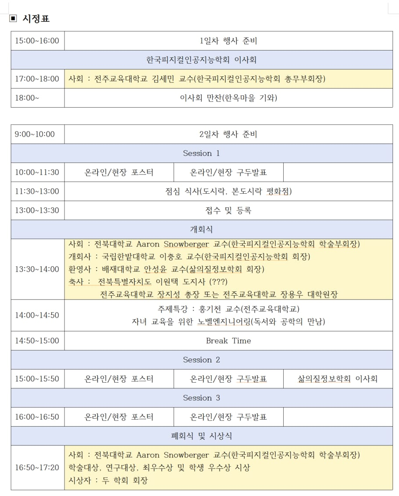

<!-- Body content is rendered by _layouts/conference.html below the info/poster block.
     Source: CFP poster v2.2 and the draft program table (assets/images/conferences/2027-kspai/).
     Each image has a bilingual text equivalent so English readers and screen readers get the content. -->

<!-- ── 논문모집 안내 / Call for Papers ── -->

  <h2 class="page-section-title">
    논문모집 안내
    Call for Papers
  </h2>
  

    

      <strong>발표문 제출 마감Submission deadline</strong> —
      2026년 12월 31일(목) 23:59까지
      Thursday, December 31, 2026, until 23:59 KST
    

    

      <a href="/submit/conference/" class="btn btn-primary">
        논문 투고 게시판 →Submit a paper →
      </a>
    

    

      <ul>
        <li>저자 중 발표자는 사전 등록을 원칙으로 합니다.</li>
        <li>발표 논문 중 우수 논문을 선정하여 심사 후 본 학회 등 각 저널에 추천합니다.</li>
        <li>단, 우수 논문에 선정되더라도 발표하지 않은 노쇼 논문은 선정이 취소됩니다.</li>
        <li>투고 논문 양식을 준수하며 분량은 2페이지입니다 (3페이지부터는 장당 1만원 추가).</li>
        <li>대학생 및 고등학생 발표 논문도 접수합니다 (학생우수상 및 학생장려상 시상).</li>
        <li>발표 형식: 구두 발표 · 포스터 발표 · 패들렛 발표</li>
      </ul>
    

    

      <ul>
        <li>Presenting authors are expected to pre-register.</li>
        <li>Outstanding papers will be selected and, after review, recommended to the societies' journals.</li>
        <li>A paper selected as outstanding loses the selection if it is not presented (no-show).</li>
        <li>Papers must follow the submission template and are 2 pages long (10,000 KRW per additional page from page 3).</li>
        <li>Papers by undergraduate and high-school students are welcome (Student Excellence and Student Encouragement awards).</li>
        <li>Presentation formats: oral, poster, and Padlet.</li>
      </ul>
    

  

  <h3 class="committee-subtitle">
    논문 투고 분야
    Submission Tracks
  </h3>
  

    <table class="fee-table">
      <thead>
        <tr>
          <th scope="col">한국피지컬인공지능학회KSPAI</th>
          <th scope="col">삶의질정보학회KLife</th>
        </tr>
      </thead>
      <tbody>
        <tr><td>피지컬AI 윤리및인문학Physical AI Ethics &amp; Humanities</td><td>삶과 교육Life &amp; Education</td></tr>
        <tr><td>피지컬AI 교육Physical AI Education</td><td>삶과 기술Life &amp; Technology</td></tr>
        <tr><td>피지컬AI 융합및창업Physical AI Convergence &amp; Entrepreneurship</td><td>삶과 간호Life &amp; Nursing</td></tr>
        <tr><td>피지컬AI 비전및인식Physical AI Vision &amp; Perception</td><td>삶과 치료Life &amp; Therapy</td></tr>
        <tr><td>피지컬AI 시스템Physical AI Systems</td><td>삶과 보건Life &amp; Public Health</td></tr>
        <tr><td>피지컬AI 국방및무기시스템Physical AI Defense &amp; Weapon Systems</td><td>삶과 복지Life &amp; Welfare</td></tr>
        <tr><td>피지컬AI 보건의료Physical AI Healthcare</td><td>삶과 관광문화Life, Tourism &amp; Culture</td></tr>
      </tbody>
    </table>
  

<!-- ── 등록비 안내 / Registration Fees ── -->

  <h2 class="page-section-title">
    등록비 안내
    Registration Fees
  </h2>
  

    <table class="fee-table">
      <thead>
        <tr>
          <th scope="col">구분Category</th>
          <th scope="col">사전등록비 (~2027. 1. 22.)Early (until Jan 22, 2027)</th>
          <th scope="col">현장등록비On-site</th>
        </tr>
      </thead>
      <tbody>
        <tr>
          <td>두 학회 연/정/종신회원Annual / regular / lifetime members of either society</td>
          <td>80,000 <small>(온라인 60,000원)(online 60,000)</small></td>
          <td class="mono">100,000</td>
        </tr>
        <tr>
          <td>대학생Undergraduate students</td>
          <td>60,000 <small>(온라인 없음)(no online option)</small></td>
          <td class="mono">80,000</td>
        </tr>
        <tr>
          <td>중/고등학생Middle / high-school students</td>
          <td>50,000 <small>(온라인 없음)(no online option)</small></td>
          <td class="mono">70,000</td>
        </tr>
        <tr>
          <td>비회원Non-members</td>
          <td>100,000 <small>(온라인 없음)(no online option)</small></td>
          <td class="mono">120,000</td>
        </tr>
      </tbody>
    </table>
  

  

    ※ 단위: 원. 추가 편수: 연/정/종신회원 4만원, 대학생 또는 중고등학생 3만원.
    ※ Amounts in KRW. Each additional paper: 40,000 for members, 30,000 for undergraduate or secondary-school students.
  

  <h3 class="committee-subtitle">
    등록비 계좌
    Bank Accounts
  </h3>
  

    <ul>
      <li>
        한국피지컬인공지능학회: 국민은행 506501-04-727246 (예금주: 한국피지컬인공지능학회)
        KSPAI: KB Kookmin Bank 506501-04-727246 (account holder: 한국피지컬인공지능학회)
      </li>
      <li>
        삶의질정보학회: 국민은행 763201-01-707181 (예금주: 삶의질연구회)
        KLife: KB Kookmin Bank 763201-01-707181 (account holder: 삶의질연구회)
      </li>
    </ul>
  

<!-- ── 시정표 / Program ── -->

  <h2 class="page-section-title">
    시정표
    Program
  </h2>
  <figure class="conf-figure">
    
  </figure>

  

    <table class="fee-table conf-program-table">
      <thead>
        <tr>
          <th scope="col">시간Time</th>
          <th scope="col">내용Session</th>
        </tr>
      </thead>
      <tbody>
        <tr class="conf-program-day"><td colspan="2">1일차 · 1월 28일 (목)Day 1 · Thursday, January 28</td></tr>
        <tr>
          <td class="mono">15:00 – 16:00</td>
          <td>1일차 행사 준비Day 1 setup</td>
        </tr>
        <tr>
          <td class="mono">17:00 – 18:00</td>
          <td>한국피지컬인공지능학회 이사회 (사회: 김세민 교수, 전주교육대학교 · 총무부회장)KSPAI Board Meeting (chair: Prof. Semin Kim, Jeonju National University of Education · VP, General Affairs)</td>
        </tr>
        <tr>
          <td class="mono">18:00 –</td>
          <td>이사회 만찬 (한옥마을 기와)Board dinner (Giwa, Jeonju Hanok Village)</td>
        </tr>
        <tr class="conf-program-day"><td colspan="2">2일차 · 1월 29일 (금)Day 2 · Friday, January 29</td></tr>
        <tr>
          <td class="mono">09:00 – 10:00</td>
          <td>2일차 행사 준비Day 2 setup</td>
        </tr>
        <tr>
          <td class="mono">10:00 – 11:30</td>
          <td>Session 1 — 온라인/현장 포스터 · 온라인/현장 구두발표Session 1 — Online/on-site posters · Online/on-site oral presentations</td>
        </tr>
        <tr>
          <td class="mono">11:30 – 13:00</td>
          <td>점심 식사Lunch</td>
        </tr>
        <tr>
          <td class="mono">13:00 – 13:30</td>
          <td>접수 및 등록Check-in &amp; registration</td>
        </tr>
        <tr>
          <td class="mono">13:30 – 14:00</td>
          <td>
            개회식 (사회: Aaron Snowberger 교수, 전북대학교) 개회사: 이충호 교수 (국립한밭대학교, 한국피지컬인공지능학회 회장) 환영사: 안성윤 교수 (배재대학교, 삶의질정보학회 회장) 축사: 추후 확정
            Opening Ceremony (MC: Prof. Aaron Snowberger, Jeonbuk National University) Opening address: Prof. Choong Ho Lee (Hanbat National University, President of KSPAI) Welcome: Prof. Sungyun Ahn (Pai Chai University, President of KLife) Congratulatory remarks: to be confirmed
          </td>
        </tr>
        <tr>
          <td class="mono">14:00 – 14:50</td>
          <td>주제특강 — 자녀 교육을 위한 노벨엔지니어링 (독서와 공학의 만남) · 홍기천 교수 (전주교육대학교)Keynote — Novel Engineering for Children's Education: Where Reading Meets Engineering · Prof. Ki-Cheon Hong (Jeonju National University of Education)</td>
        </tr>
        <tr>
          <td class="mono">14:50 – 15:00</td>
          <td>휴식Break</td>
        </tr>
        <tr>
          <td class="mono">15:00 – 15:50</td>
          <td>Session 2 — 온라인/현장 포스터 · 온라인/현장 구두발표 · 삶의질정보학회 이사회Session 2 — Online/on-site posters · Online/on-site oral presentations · KLife Board Meeting</td>
        </tr>
        <tr>
          <td class="mono">16:00 – 16:50</td>
          <td>Session 3 — 온라인/현장 포스터 · 온라인/현장 구두발표Session 3 — Online/on-site posters · Online/on-site oral presentations</td>
        </tr>
        <tr>
          <td class="mono">16:50 – 17:20</td>
          <td>폐회식 및 시상식 — 학술대상, 연구대상, 최우수상 및 학생 우수상 시상 (시상: 두 학회 회장)Closing &amp; Awards — Academic Grand Prize, Research Grand Prize, Grand Award, Student Excellence Awards (presented by both society presidents)</td>
        </tr>
      </tbody>
    </table>
  

  

    ※ 세부적인 발표시간과 발표장소는 추후 안내장으로 공지합니다. 행사 당일 간단한 기념품 및 중식이 제공됩니다.
    ※ Detailed presentation times and rooms will be announced later. A small souvenir and lunch are provided on the day.
  

<!-- ── 문의 / Inquiries ── -->

  <h2 class="page-section-title">
    문의
    Inquiries
  </h2>
  

    <ul>
      <li>한국피지컬인공지능학회 담당자KSPAI: <a href="tel:01094789153" class="mono">010-9478-9153</a></li>
      <li>삶의질정보학회 담당자KLife: <a href="tel:0415642023" class="mono">041-564-2023</a> · <a href="mailto:paper@klife.re.kr">paper@klife.re.kr</a></li>
      <li>공동학술대회 홈페이지Conference websites: <a href="https://kspai.org">kspai.org</a> · <a href="http://klife.re.kr" target="_blank" rel="noopener">klife.re.kr</a></li>
    </ul>
  

